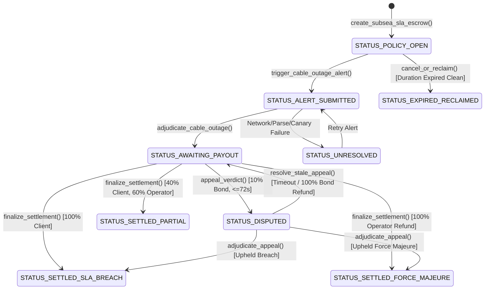

# Technical Architecture & Specification — AgentSubseaCable

Autonomous Transoceanic Fiber Optic Cable SLA & Seismic Risk Escrow  
Target Network: GenLayer StudioNet (Chain ID: `61999` / Hex `0xF22F`, RPC: `https://studio.genlayer.com/api`)

---

## 1. System Overview & The Trilemma of Subsea Cable SLAs

Submarine fiber-optic cables carry over **95% of international internet data traffic**. Global telecom consortia and cloud hyperscalers purchase dedicated spectrum and dark fiber capacity under strict Service Level Agreements (SLAs) with latency (Round-Trip Time, RTT) and packet continuity guarantees.

When an ocean cable is severed or suffers severe optical degradation:
1. **Root Cause Ambiguity:** It takes weeks to months for cable repair ships to retrieve and inspect seabed faults. Cable operators often claim natural catastrophes (submarine earthquakes, turbidity currents) under **Force Majeure**, while telecom carriers claim mechanical damage (trawling, anchor dragging) demanding 100% SLA indemnity penalties.
2. **Oracle Failure in Traditional EVM:** Standard smart contracts cannot parse live optical time-domain reflectometry (OTDR), BGP routing anomalies, or USGS seafloor seismic feeds.
3. **The GenLayer Solution:** AgentSubseaCable uses GenLayer's non-deterministic web rendering (`gl.nondet.web.render`) and multi-validator AI consensus (`gl.vm.run_nondet`) to autonomously cross-examine optical telemetry against real-time global hydrographic and seismic networks.

---

## 2. Core Protocol State Machine



### Protocol Lifecycle Status Codes
| Status Code | Constant Name | Description |
|---|---|---|
| `u8(0)` | `STATUS_POLICY_OPEN` | Operator deposited SLA indemnity escrow. Monitored active link. |
| `u8(1)` | `STATUS_ALERT_SUBMITTED` | Client filed verified OTDR / seismic telemetry endpoint. |
| `u8(2)` | `STATUS_AWAITING_PAYOUT` | AI Subsea Tribunal rendered verdict; 24-block (~72s) cooling window active. |
| `u8(3)` | `STATUS_SETTLED_SLA_BREACH` | Confirmed technical failure; 100% escrow disbursed to client. |
| `u8(4)` | `STATUS_SETTLED_PARTIAL` | Moderate latency degradation (> agreed SLA); 40% disbursed to client, 60% refunded. |
| `u8(5)` | `STATUS_SETTLED_FORCE_MAJEURE` | Submarine earthquake ($\ge 5.5\text{ Richter}$) verified; SLA penalty excused. |
| `u8(6)` | `STATUS_DISPUTED` | Under appellate review with 10% staked bond. |
| `u8(7)` | `STATUS_EXPIRED_RECLAIMED` | Policy concluded without incidents; escrow reclaimed by operator. |
| `u8(8)` | `STATUS_UNRESOLVED` | Protected non-settling state for network, parse, or canary failures. |

---

## 3. Mathematical SLA & Decision Matrix

Let:
- $L_{\text{target}}$: Maximum tolerable round-trip time in milliseconds ($p.\text{max\_tolerable\_latency\_ms}$).
- $L_{\text{measured}}$: Observed optical round-trip time in milliseconds extracted from OTDR telemetry.
- $M_{\text{seismic}}$: Detected seabed earthquake magnitude on the Richter scale ($p.\text{detected\_magnitude\_richter} / 10.0$).
- $E$: SLA Indemnity Escrow deposited in GEN ($p.\text{escrow\_amount}$).

$$\text{Decision}(L_{\text{measured}}, M_{\text{seismic}}) = \begin{cases}
\text{FORCE\_MAJEURE\_EARTHQUAKE\_VERIFIED} & \text{if } M_{\text{seismic}} \ge 5.5 \\
\text{OUTAGE\_SLA\_BREACH\_COMPENSATED} & \text{if } M_{\text{seismic}} < 5.5 \text{ and } (L_{\text{measured}} \ge 2 \cdot L_{\text{target}} \text{ or } L_{\text{measured}} \ge 5000) \\
\text{PARTIAL\_LATENCY\_DEGRADATION} & \text{if } M_{\text{seismic}} < 5.5 \text{ and } L_{\text{target}} < L_{\text{measured}} < 2 \cdot L_{\text{target}} \\
\text{FORCE\_MAJEURE\_EARTHQUAKE\_VERIFIED} & \text{if } L_{\text{measured}} \le L_{\text{target}} \text{ (Link Compliant)}
\end{cases}$$

### Financial Disbursement Schedule:
- **Full SLA Breach:** Client receives $1.00 \cdot E$.
- **Partial Latency Degradation:** Client receives $0.40 \cdot E$; Operator receives $0.60 \cdot E$.
- **Force Majeure / Compliant:** Operator receives $1.00 \cdot E$ refund.

---

## 4. Multi-Validator Consensus & Cryptographic Integrity

### Dual-Validator Determinism
1. **Leader Execution:**
   - Renders live web endpoint using `gl.nondet.web.render(feed_url, mode="text")`.
   - Hashes raw payload via SHA-256 (`evidence_hash`).
   - Prompts GenLayer LLM to extract JSON telemetry with `CANARY_AGENT_SUBSEA_CABLE_V1`.
2. **Validator Execution:**
   - Re-fetches the telemetry feed independently.
   - Computes its own SHA-256 hash.
   - Compares the extracted `evidence_hash`, `cable_system_id`, and ensures latency difference $\Delta L \le 20\text{ ms}$.
   - Checks matching verdict before signing the block transaction.

### Pure Pull-Payment Ledger Architecture
To eliminate all reentrancy and token-locking vulnerabilities, the contract uses internal ledger accounting:
```python
def _credit_payout(self, recipient: Address, amount: bigint) -> None:
    rec_str = _addr_str(_to_address(recipient))
    curr = self.claimable_balances.get(rec_str, bigint(0))
    self.claimable_balances[rec_str] = curr + amount
    self.total_pending_claims = self.total_pending_claims + amount
```
Recipients withdraw explicitly via `claim_payout()`.

---

## 5. Security & Boundary Guarantees
- **Accredited Source Domain Whitelist:** Strictly filters sources against `submarinecablemap.com`, `telegeography.com`, `earthquake.usgs.gov`, `ndbc.noaa.gov`, `ripe.net`, and `emsc-csem.org`.
- **Canary Injection Defense:** Guaranteed rejection of prompt injection attacks via canary token matching.
- **Bounded Timeout Recovery:** 7-day timeout guarantee ensures staked dispute bonds are never trapped if appellate data stalls.
