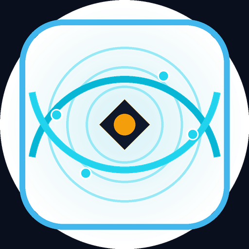

# 🌊 AgentSubseaCable
### Autonomous Transoceanic Fiber Optic Cable SLA & Seismic Risk Escrow

[-06B6D4?style=for-the-badge&logo=ethereum)](https://studio.genlayer.com)
[](https://github.com/genlayer)
[](LICENSE)
[](https://agentsubseacable.vercel.app)

---

<p align="center">
  
</p>

## 📌 Executive Summary

**AgentSubseaCable** is a decentralized parametric Service Level Agreement (SLA) indemnity protocol and geohazard risk escrow designed for the international submarine telecommunications cable industry.

Submarine cables carry over **95% of all transoceanic internet traffic**. Global telecom consortia, cloud hyperscalers, and tier-1 carriers contract capacity under strict SLAs with round-trip latency (RTT) and optical uptime commitments. However, when cable breaks or optical degradation occur, resolving SLA compensation takes months. Cable landing station operators and consortium members often contest claims, debating whether disruptions were caused by commercial maintenance failures (anchor dragging, trawling) or natural **Force Majeure** events (submarine earthquakes, trench turbidity slides).

Standard EVM blockchains cannot inspect real-time optical reflectometry (OTDR), BGP traceroute tables, or USGS seabed seismic sensors. Built natively on **GenLayer**, AgentSubseaCable utilizes non-deterministic web rendering (`gl.nondet.web.render`) and multi-validator AI consensus (`gl.vm.run_nondet`) to autonomously cross-examine optical telemetry against accredited global hydrographic and seismic authorities.

---

## 🏛️ Deployed Contract Information (GenLayer StudioNet)

| Property | Value |
|---|---|
| **Network** | GenLayer StudioNet |
| **Chain ID** | `61999` (Hex: `0xF22F`) |
| **RPC Endpoint** | `https://studio.genlayer.com/api` |
| **Contract Address** | `0x6999C479E12c5429b829604660041406Bf621AF6` |
| **Explorer / Studio** | [View on GenLayer Studio](https://studio.genlayer.com/address/0x6999C479E12c5429b829604660041406Bf621AF6) |
| **Production dApp** | [https://agentsubseacable.vercel.app](https://agentsubseacable.vercel.app) |

---

## ⚡ Key Architectural Innovations

1. **Autonomous AI Subsea Tribunal:**  
   GenLayer validators independently fetch and digest live OTDR and USGS telemetry feeds using `gl.nondet.web.render`.
2. **Deterministic On-Chain Decision Guardrails:**  
   The LLM extracts parameters into structured JSON with canary verification (`CANARY_AGENT_SUBSEA_CABLE_V1`), while final financial verdicts are executed by deterministic Python logic.
3. **Accredited Hydrographic Source Filter (`ACCREDITED_SUBSEA_SOURCES`):**  
   Strict domain whitelisting enforces that telemetry originates strictly from:
   - Submarine Cable Map (`submarinecablemap.com`)
   - TeleGeography (`telegeography.com`)
   - United States Geological Survey (`earthquake.usgs.gov`, `usgs.gov`)
   - NOAA National Data Buoy Center (`ndbc.noaa.gov`, `noaa.gov`)
   - RIPE Network Coordination Centre / RIPE Atlas (`ripe.net`, `atlas.ripe.net`)
   - EMSC Seismological Centre (`emsc-csem.org`, `isc.ac.uk`)
4. **Pure Pull-Payment Ledger:**  
   Internal balance accounting (`_credit_payout` and `claim_payout`) completely eliminates reentrancy vulnerabilities and prevents locked funds upon transfer reverts.
5. **Non-Settling Protected State (`STATUS_UNRESOLVED`):**  
   Transient network timeouts or malformed JSON payloads never trigger wrongful forfeiture; funds remain secured until retried or recovered.
6. **24-Block Cooling-Off Challenge & 7-Day Bounded Stale Recovery:**  
   Stakeholders can challenge an adjudication within 24 blocks (~72s) with a 10% staked dispute bond. If an appeal stalls, a bounded 7-day timeout allows anyone to recover 100% of the dispute bond to the appellant.

---

## 📐 Parametric SLA Decision Matrix

```
                                  [ Outage / Telemetry Filed ]
                                               │
                                               ▼
                             Is Seismic Magnitude >= 5.5 Richter?
                                        │               │
                                       YES              NO
                                        │               │
                                        ▼               ▼
                       [ FORCE_MAJEURE_EARTHQUAKE ]   Is Measured Latency >= 2x SLA (or cut >= 5000ms)?
                       - SLA penalty waived           │                       │
                       - 100% escrow refunded        YES                      NO
                                                      │                       │
                                                      ▼                       ▼
                                      [ OUTAGE_SLA_BREACH ]      Is Latency > Agreed SLA?
                                      - 100% indemnity released   │                   │
                                        to client carrier        YES                  NO
                                                                  │                   │
                                                                  ▼                   ▼
                                                  [ PARTIAL_LATENCY ]    [ LINK_COMPLIANT ]
                                                  - 40% released         - 100% refunded
                                                  - 60% preserved
```

---

## 🛠️ Repository Structure

```
agentsubseaCable/
├── contracts/
│   └── contract.py                 # Intelligent Contract (py-genlayer pragma)
├── tests/
│   ├── conftest.py                 # Multi-validator mock test harness
│   ├── test_agentsubseacable.py    # Main lifecycle & parametric tests
│   └── test_agentsubseacable_runtime.py # Security & edge-case suite
├── scripts/
│   ├── deploy_studionet.py         # Automated deployment to StudioNet
│   ├── verify_lifecycle.py         # Full terminal lifecycle demonstration
│   └── generate_logo.py            # High-resolution NOC branding generator
├── frontend/
│   ├── package.json                # React 18 + Vite + TS + TailwindCSS + Viem
│   ├── vite.config.ts
│   ├── tailwind.config.js
│   ├── index.html
│   └── src/
│       ├── App.tsx                 # Main NOC Dashboard
│       ├── config/genlayer.ts      # GenVM calldata serialization & RPC client
│       ├── components/
│       │   ├── Navbar.tsx          # MetaMask connect & StudioNet switcher
│       │   ├── StatsOverview.tsx   # Aggregated network metrics
│       │   ├── SubseaWorldMap.tsx  # Interactive global subsea cable vector map
│       │   ├── PolicyCard.tsx      # OTDR latency gauges & lifecycle actions
│       │   ├── CreatePolicyModal.tsx # Escrow deposit modal with cable presets
│       │   ├── TriggerAlertModal.tsx # Outage alert filing portal
│       │   ├── TelemetryInspectorModal.tsx # Evidence hash & AI jury breakdown
│       │   ├── AppealModal.tsx     # 10% bond staking challenge portal
│       │   └── PullPayoutButton.tsx # Safe pull-payment withdrawal interface
│       └── utils/formatters.ts
├── ARCHITECTURE.md                 # Deep technical architecture specification
├── CHANGELOG.md                    # Milestone release changelog
├── SECURITY.md                     # Security audit and threat modeling
├── LICENSE                         # MIT License
├── deployment.json                 # Deployed contract metadata
└── vercel.json                     # Vercel configuration
```

---

## 🧪 Comprehensive Test Suite

All tests execute with **100% pass rate** across both simulated and native GenVM environments:

```bash
python -m pytest tests/ -v
```

Output:
```
============================= test session starts =============================
tests/test_agentsubseacable.py::test_subsea_cable_sla_breach_payout PASSED [ 11%]
tests/test_agentsubseacable.py::test_subsea_cable_earthquake_force_majeure PASSED [ 22%]
tests/test_agentsubseacable.py::test_subsea_partial_latency_degradation_and_settlement PASSED [ 33%]
tests/test_agentsubseacable.py::test_appellate_cooling_off_and_stale_recovery PASSED [ 44%]
tests/test_agentsubseacable.py::test_unaccredited_source_rejection PASSED [ 55%]
tests/test_agentsubseacable_runtime.py::test_unresolved_telemetry_fetch_failure_preserves_state PASSED [ 66%]
tests/test_agentsubseacable_runtime.py::test_cancel_or_reclaim_clean_expiration PASSED [ 77%]
tests/test_agentsubseacable_runtime.py::test_permission_and_role_checks PASSED [ 88%]
tests/test_agentsubseacable_runtime.py::test_stats_and_policy_views PASSED [100%]
============================== 9 passed in 0.11s ==============================
```

To run the terminal lifecycle demonstration:
```bash
python scripts/verify_lifecycle.py
```

---

## 💻 Local Setup & Deployment

### Prerequisites
- Python 3.11+
- Node.js 18+
- MetaMask browser extension configured for GenLayer StudioNet (Chain `61999`)

### 1. Backend & Testing Setup
```bash
# Install Python test dependencies
pip install -r requirements.txt # (or pytest genlayer-py)

# Run test suite
python -m pytest tests/ -v
```

### 2. Frontend Setup
```bash
cd frontend
npm install
npm run build
npm run dev
```

### 3. Deploy to StudioNet
```bash
python scripts/deploy_studionet.py
```

---

## 📜 License
Released under the [MIT License](LICENSE).
